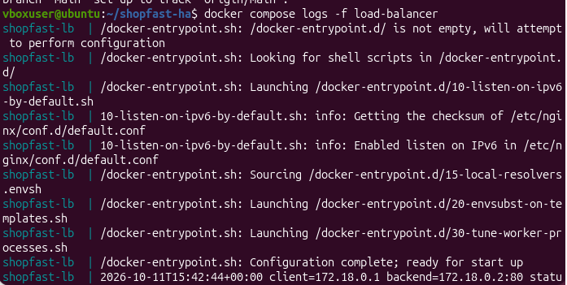

# ShopFast High-Availability Web Service with Load Balancing

**Name:** Jubayer Ahmed  
**Batch:** 14  
**Chosen Option:** Option B – NGINX Load Balancer (Local)

---

## 1. Project Overview

This project demonstrates a high-availability web service using open-source NGINX and two web-server containers. The load balancer distributes HTTP requests between two simulated Availability Zones (AZs).

Each application server exposes a dedicated `/health` endpoint. NGINX uses passive failure detection to avoid repeatedly routing traffic to a failing backend.

The main objectives are to:

- Distribute incoming HTTP requests across two web servers.
- Monitor backend health.
- Test failure handling and recovery.
- Identify which instance serves each request.
- Record access logs and document test results.

## 2. Architecture

```text
                   User / Browser
                         |
                         |
                  localhost:8080
                         |
                         v
                 NGINX Load Balancer
                    /         \
                   /           \
                  v             v
          Simulated AZ-A  Simulated AZ-B
              web-a           web-b
           Instance 1      Instance 2
           /health          /health
                   \         /
                    \       /
                  HTTP Responses
```

### Architecture Components

| Component | Implementation | Purpose |
|---|---|---|
| User | Browser or curl | Sends HTTP requests |
| Load Balancer | NGINX | Distributes requests to backend servers |
| Simulated AZ-A | Docker network `shopfast-az-a` | Isolates the first backend network |
| Simulated AZ-B | Docker network `shopfast-az-b` | Isolates the second backend network |
| Web Server 1 | `shopfast-web-a` | Serves Instance 1 |
| Web Server 2 | `shopfast-web-b` | Serves Instance 2 |
| Health Endpoint | `/health` | Returns HTTP 200 when the web server is responding |
| Access Logs | NGINX access log | Records requests and upstream information |

**Network design:** Only the load balancer publishes a host port (`8080`). The backend containers do not publish their HTTP ports directly to the host.

**Limitation:** The simulated AZs use separate Docker bridge networks, but both application servers run on the same physical host. Therefore, this setup does not provide true physical or host-level availability-zone redundancy.

## 3. Technologies Used

- Docker
- Docker Compose
- NGINX Open Source
- Ubuntu Linux
- Git and GitHub
- curl

## 4. Project Structure

```text
shopfast-ha/
├── docker-compose.yml
├── nginx/
│   └── nginx.conf
├── web/
│   ├── index.html
│   └── default.conf.template
├── screenshots/
│   ├── T1-health-status.png
│   ├── T2-load-distribution.png
│   ├── T3-browser-test.png
│   ├── T4-az-failure.png
│   ├── T5-recovery.png
│   └── T6-access-logs.png
├── .gitignore
└── README.md
```

## 5. Setup and Installation

### Prerequisites

Install Docker Engine and the Docker Compose plugin on Ubuntu.

Verify the installation:

```bash
docker --version
docker compose version
```

### Step 1: Clone the Repository

```bash
git clone https://github.com/jubayerdevs/shopfast-ha.git
cd shopfast-ha
```

### Step 2: Validate the Docker Compose Configuration

```bash
docker compose config
```

This command checks whether the Compose configuration is valid.

### Step 3: Start the Application

```bash
docker compose up -d
```

### Step 4: Check Container Status

```bash
docker compose ps
```

Confirm that both backend containers are running and become healthy.

### Step 5: Validate NGINX

```bash
docker exec shopfast-lb nginx -t
```

The configuration test should report that the syntax is OK and the test is successful.

### Step 6: Open the Application

Open the following address in a browser:

**http://localhost:8080**

The ShopFast application should display information about the backend instance serving the request.

## 6. Health Checks and Failure Detection

Both backend servers expose a dedicated `/health` endpoint that returns HTTP 200 when the web server responds successfully.

### Docker Health-Check Configuration

| Setting | Value | Purpose |
|---|---|---|
| Health endpoint | `/health` | Checks backend responsiveness |
| Interval | 5 seconds | Frequency of health checks |
| Timeout | 2 seconds | Maximum wait for each check |
| Retries | 2 | Failures required before Docker marks the container unhealthy |
| Start period | 3 seconds | Initial startup grace period |

### NGINX Passive Health Checks

The NGINX upstream configuration uses:

```nginx
server web-a:80 max_fails=1 fail_timeout=10s;
server web-b:80 max_fails=1 fail_timeout=10s;
```

- `max_fails=1`: One qualifying failure can mark the server unavailable temporarily.
- `fail_timeout=10s`: Defines the failure observation period and temporary exclusion period.

### Active vs. Passive Health Checks

**Active health checks** periodically send requests to a backend health endpoint independently of user traffic.

**Passive health checks** identify backend failures while handling actual user requests.

Docker performs health checks against each local container. However, standard NGINX Open Source does not automatically remove an upstream server based on Docker's health status. NGINX uses passive upstream failure detection in this configuration.

Consequently, a failed backend may cause an initial request error or retry before NGINX avoids that backend. This implementation should not be considered equivalent to AWS ALB active target health checks.

## 7. Testing and Evidence

The following tests are used to evaluate load distribution, health monitoring, failure handling and recovery.

> Replace each placeholder below with your actual test result. Add the corresponding screenshot to the `screenshots/` directory.

### T1 – Health Status

**Command:**

```bash
docker compose ps
```

For detailed health status:

```bash
docker inspect --format='{{.Name}}: {{.State.Health.Status}}' \
  shopfast-web-a shopfast-web-b
```

**Expected result:** Both backend containers are running and healthy.

**Actual result:** _Record your observed result._


### T2 – Load Distribution

**Command:**

```bash
for i in $(seq 1 10); do
  curl -s http://localhost:8080/instance-info
  echo
done
```

**Expected result:** Responses identify both Instance 1 (AZ-A) and Instance 2 (AZ-B).

**Actual result:** _Record how many requests reached each instance._


### T3 – Browser Test

Open the application:

http://localhost:8080

Refresh the page several times and observe the instance information.

**Expected result:** The application displays the identity of the backend serving the request.

**Actual result:** _Record your observation._


### T4 – AZ-A Failure

**Command:**

```bash
docker compose stop web-a
```

Send requests to the load balancer:

```bash
for i in $(seq 1 10); do
  curl --max-time 5 -sS http://localhost:8080/instance-info
  echo
done
```

**Expected result:** After failure detection, requests should be served by the surviving backend in AZ-B. Record any errors during the transition.

**Actual result:** _Record whether all requests succeeded and which instance responded._


### T5 – Recovery

**Command:**

```bash
docker compose start web-a
```

Wait until Docker reports that the backend is healthy, then send requests again.

```bash
until [ "$(docker inspect -f '{{.State.Health.Status}}' shopfast-web-a)" = "healthy" ]; do
  sleep 2
done
```

```bash
for i in $(seq 1 10); do
  curl -s http://localhost:8080/instance-info
  echo
done
```

**Expected result:** The recovered backend becomes reachable again and traffic resumes reaching both backends.

**Actual result:** _Record your observed recovery behavior._


### T6 – Access Logs and Monitoring

**Command:**

```bash
docker compose logs --tail=50 load-balancer
```

To follow logs continuously:

```bash
docker compose logs -f load-balancer
```

**Expected result:** The access logs show incoming requests, HTTP status codes and upstream addresses.

**Actual result:** _Record what the logs show._



## 8. Reflection

### 8.1 AWS Application Load Balancer vs. NGINX

AWS Application Load Balancer is a managed service that supports target groups, active health checks, and integration with EC2 instances across multiple Availability Zones. AWS manages the underlying load-balancing infrastructure, reducing operational work. However, AWS resources can incur charges and require cloud configuration.

NGINX Open Source is a flexible, lightweight reverse proxy that can distribute traffic across backend servers. It is useful for local labs because it runs without a paid cloud service and gives administrators direct control over configuration and logs. However, infrastructure, configuration and high availability must be managed separately. Its standard upstream failure detection is passive rather than the native active target health checking offered by AWS ALB. This project also simulates AZs using Docker networks on a single host, so it cannot demonstrate real multi-AZ infrastructure resilience.

### 8.2 What Happens If the Load Balancer Fails?

If the only NGINX load balancer fails, users cannot reach the backend servers through the application's entry point, even if both backends are healthy. The load balancer is therefore a single point of failure in this local design.

A production system can reduce this risk by deploying redundant load balancers across separate Availability Zones and using a managed load-balancing service or a highly available virtual IP mechanism. Monitoring, automated recovery, health checks and tested failover procedures help minimize service disruption. A redundant load balancer must itself be monitored and designed to avoid introducing another single point of failure.

### 8.3 Problem Encountered and Solution

One technical challenge was understanding the difference between Docker health checks and NGINX upstream failure detection. Docker can report that a backend container is unhealthy, but standard NGINX Open Source does not automatically consume that health status to remove the backend from its upstream pool.

The solution was to configure Docker health checks for the `/health` endpoint and NGINX passive failure detection using `max_fails` and `fail_timeout`. Upstream retries were configured for eligible failures. Stopping and restarting a backend provides a practical way to observe failover and recovery behavior. The results are checked using curl and the NGINX access logs. The remaining limitation is that passive detection cannot guarantee that every request succeeds during a backend failure.

## 9. Cleanup

After collecting the required evidence, stop and remove the containers and Docker networks:

```bash
docker compose down
```

## 10. Conclusion

This project demonstrates a local load-balanced web service using NGINX, Docker Compose and two simulated Availability Zones. It covers traffic distribution, health endpoints, passive failure detection, backend recovery and access-log analysis.

The exercise also highlights the difference between local network isolation and true infrastructure-level high availability, as well as the importance of validating failover behavior with real test results.

## 11. Repository

**GitHub:** https://github.com/jubayerdevs/shopfast-ha
